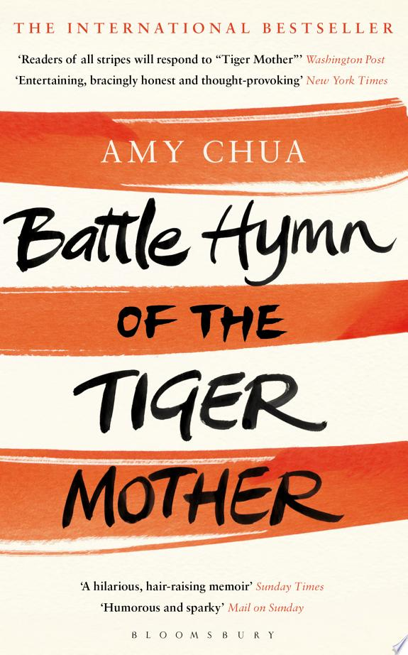

::: {.media-cover}
{fig-alt="Cover"}
:::

Nice read into the life of asian families in america and i think it is quite relatable, although it mainly pertains to music and the pursuit of it. I thought it would contain more about the lives of her children compared to just music but overall still nice

## Reading Journey

- 2025-10-31: Finished