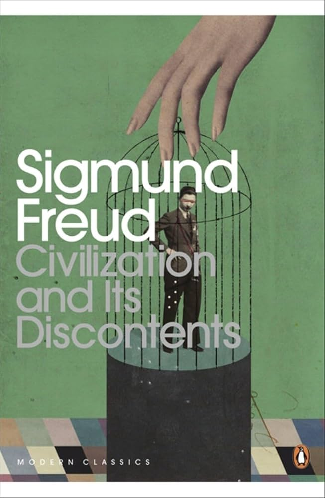

::: {.media-cover}
{fig-alt="Cover"}
:::

# Modern Classics Civilization and Its Discontent

## Reading Notes

## Reading Journey
- 2025-11-01: Started
- 2025-11-01: 14
    - 3 mins
- 2025-11-01: 16
    - 2 mins
- 2025-11-05: 21
    - 5 mins
- 2025-11-07: 24
    - 2 mins
- 2026-07-20: 29
    - 2 mins
- 2026-07-20: 48
    - 29 mins
- 2026-07-23: 49
    - 2 mins
- Total Time Taken: 45 minutes

## Bookmarks
> One may rightly call oneself religious on the ground of this oceanic feeling alone, even though one reject all beliefs and all illusions.
> *2025-10-31*

> all pain is but  sensation; it only exists in so far as we feel it, and we feel it only in consequence of certain characteristics of our organism
> *2025-11-22*

> We cannot dispense with auxiliary constructions, as Theodor Fontane said. There are perhaps three of these means: powerful diversions of interest, which lead us to care little about our misery; substitutive gratification, which lessen it; and intoxicating substances, which make us insensitive to it. Something of this kind is indispensable
> *2025-11-22*