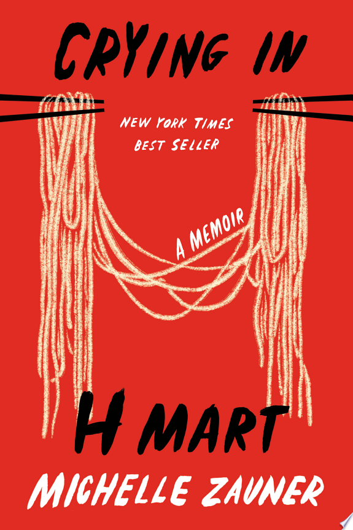

::: {.media-cover}
{fig-alt="Cover"}
:::

Nice book, maybe it was because it was an iffy time in my life in exchange where i was kind of changing and doing things. I really do believe people change during exchange though because i felt like i did i have just learnt to let things go alot more and be alot more at peace with myself, maybe it was because of the unque experiences that exchange brings not soley because of exchange itself but also the people that you meet and the relationships that you form that really shape you. But i digress, this book made me cry a few times because it spoke of the love a Korean child immigrant has for her mother and how much a mother can lover her child and it brings to mind the unique style of asian parenting that really only an asian child can recognise and understand. Overall amazing amazing book i loved it really well written

## Reading Journey
- 2025-11-01: Started
- 2025-11-01: 2
    - 1 mins
- 2025-11-01: Finished
- Total Time Taken: 1 minutes