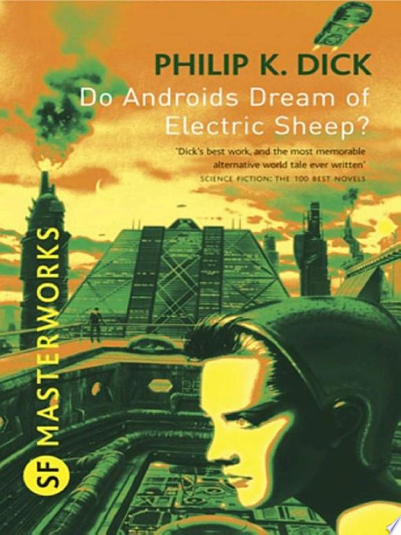

::: {.media-cover}
{fig-alt="Cover"}
:::

Interesting idea but i think the writing wasn’t great

Story about a bounty hunter in a post apocalyptic world where animals are scarce and their electronic versions are showpieces and he has to hunt down androids that act like humans and the technology improves where he cannot differentiate human and android. Then he goes home to his electric sheep lol.

## Reading Journey

- 2025-10-31: Finished