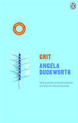

::: {.media-cover}
{fig-alt="Cover"}
:::

-“Our potential is one thing. What we do with it is quite another.”

“At the extreme, one might call your focus obsessive. Most of your actions derive their significance from their allegiance to your ultimate concern, your life philosophy.
You have your priorities in order.”

“Well, I don’t really think in terms of disappointment. I tend to think that everything that happens is something I can learn from. I tend to think, ‘Well okay, that didn’t go so well, but I guess I will just carry on.’ ”

“I’ve since measured growth mindset and grit in both younger children and older adults, and in every sample, I’ve found that growth mindset and grit go together.”

## Reading Journey
- 2026-03-02: Started
- 2026-03-02: 31
    - 41 mins
- 2026-03-04: 85
    - 42 mins
- 2026-03-05: 93
    - 10 mins
- 2026-03-11: 108
    - 24 mins
- 2026-03-16: 130
    - 22 mins
- 2026-03-17: 157
    - 28 mins
- 2026-04-23: 185
    - 28 mins
- 2026-04-24: 199
    - 9 mins
- 2026-04-26: 240
    - 45 mins
- 2026-05-05: 265
    - 30 mins
- 2026-05-12: 293
    - 29 mins
- 2026-05-13: 294
    - 1 mins
- 2026-05-13: 296
    - 2 mins
- 2026-05-13: Finished
- Total Time Taken: 5 hours and 11 minutes

## Bookmarks
> I like to think of a growth mindset this way: Some of us believe, deep down, that people really can change. These growth-oriented people assume that it’s possible, for example, to get smarter if you’re given the right opportunities and support and if you try hard enough and if you believe you can do it. Conversely, some people think you can learn skills, like how to ride a bike or do a sales pitch, but your capacity to learn skills—your talent—can’t be trained
> *2026-04-24*

> Language is one way to cultivate hope. But modeling a growth mindset—demonstrating by our actions that we truly believe people can learn to learn—may be even more important
> *2026-04-24*

> There have been times in my career where I felt discouraged. I’d watch someone else get promoted before me. I’d want things to go a certain way, and they’d go the opposite. At those points, I’d say to myself, ‘Just keep working hard and learning, and it will all work out
> *2026-04-24*

> In other words, what didn’t kill the young rats, when by their own efforts they could control what was happening, made them stronger for life.
> *2026-04-26*

> In no uncertain terms, Steve and his siblings were made to understand that, whatever they signed up for, they had to see it through to the end. “We told them, you’ve got to go to all the practices. You can’t say, ‘Oh, I’m tired of this.’ Once you commit, you discipline yourself to do it. There’s going to be times you don’t want to go, but you’ve got to go.”
> *2026-04-26*

> Regardless of gender, ethnicity, social class, or parents’ marital status, teens with warm, respectful, and demanding parents earned higher grades in school, were more self-reliant, suffered from less anxiety and depression, and were less likely to engage in delinquent behavior. The same pattern replicates in nearly every nation that’s been studied and at every stage of child development
> *2026-04-26*

> This brings me to the second part of the Hard Thing Rule: You can quit. But you can’t quit until the season is over, the tuition payment is up, or some other “natural” stopping point has arrived. You must, at least for the interval to which you’ve committed yourself, finish whatever you begin. In other words, you can’t quit on a day when your teacher yells at you, or you lose a race, or you have to miss a sleepover because of a recital the next morning. You can’t quit on a bad day
> *2026-05-12*

> It is not the critic who counts; not the man who points out how the strong man stumbles, or where the doer of deeds could have done them better. The credit belongs to the man who is actually in the arena, whose face is marred by dust and sweat and blood; who strives valiantly; who errs, who comes short again and again, because there is no effort without error and shortcoming; but who does actually strive to do the deeds; who knows great enthusiasms, the great devotions; who spends himself in a worthy cause; who at the best knows in the end the triumph of high achievement, and who at the worst, if he fails, at least fails while daring greatly, so that his place shall never be with those cold and timid souls who neither know victory nor defeat
> *2026-05-12*

> The true joy in life is to be a force of fortune instead of a feverish, selfish little clod of ailments and grievances complaining that the world will not devote itself to making you happy.
> *2026-05-12*

> Success is never final; failure is never fatal. It’s courage that counts
> *2026-05-12*

> The first is that you can grow your grit.
> I see two ways to do so. On your own, you can grow your grit “from the inside out”: You can cultivate your interests. You can develop a habit of daily challenge-exceeding-skill practice. You can connect your work to a purpose beyond yourself. And you can learn to hope when all seems lost.
> You can also grow your grit “from the outside in.” Parents, coaches, teachers, bosses, mentors, friends—developing your personal grit depends critically on other people
> *2026-05-12*

> My second closing thought is about happiness. Success—whether measured by who wins the National Spelling Bee, makes it through West Point, or leads the division in annual sales—is not the only thing you care about. Surely, you also want to be happy. And while happiness and success are related, they’re not identical.
> You might wonder, If I get grittier and become more successful, will my happiness plummet?
> *2026-05-12*

> To be gritty is to fall down seven times, and rise eight.
> *2026-05-12*

> If you define genius as being able to accomplish great things in life without effort, then he was right: I’m no genius, and neither is he.
> But if, instead, you define genius as working toward excellence, ceaselessly, with every element of your being—then, in fact, my dad is a genius, and so am I, and so is Coates, and, if you’re willing, so are you.
> *2026-05-12*

> Great things are accomplished by those “people whose thinking is active in one direction, who employ everything as material, who always zealously observe their own inner life and that of others, who perceive everywhere models and incentives, who never tire of combining together the means available to them.”
> *2026-03-04*

> Together, the research reveals the psychological assets that mature paragons of grit have in common. There are four. They counter each of the buzz-killers listed above, and they tend to develop, over the years, in a particular order.
First comes interest. Passion begins with intrinsically enjoying what you do. Every gritty person I’ve studied can point to aspects of their work they enjoy less than others, and most have to put up with at least one or two chores they don’t enjoy at all. Nevertheless, they’re captivated by the endeavor as a whole. With enduring fascination and childlike curiosity, they practically shout out, “I love what I do!”
Next comes the capacity to practice.
> *2026-03-11*

> And, finally, hope. Hope is a rising-to-the-occasion kind of perseverance. In this book, I discuss it after interest, practice, and purpose—but hope does not define the last stage of grit. It defines every stage.
> *2026-03-11*

> Third is purpose. What ripens passion is the conviction that your work matters. For most people, interest without purpose is nearly impossible to sustain for a lifetime. It is therefore imperative that you identify your work as both personally interesting and, at the same time, integrally connected to the well-being of others
> *2026-03-11*

> around the time children enter kindergarten, they begin to notice that their mistakes inspire certain reactions in grown-ups. What do we do? We frown. Our cheeks flush a bit. We rush over to our little ones to point out that they’ve done something wrong. And what’s the lesson we’re teaching? Embarrassment. Fear. Shame.
> *2026-03-17*

> This seminal experiment proved for the first time that it isn’t suffering that leads to hopelessness. It’s suffering you think you can’t control
> *2026-04-23*