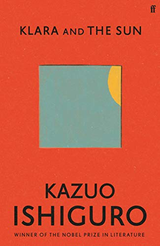

::: {.media-cover}
{fig-alt="Cover"}
:::

## Summary

## Reading Journey
- 2026-07-22: Started
- 2026-07-22: 3
    - 1 mins
- 2026-08-12: 7
    - 1 mins
- 2026-08-12: 13
    - 2 mins
- 2026-08-17: 27
    - 16 mins
- 2026-08-17: 31
    - 4 mins
- 2026-08-17: 38
    - 14 mins
- 2026-08-17: 55
    - 17 mins
- 2026-08-18: 87
    - 33 mins
- 2026-08-29: 88
    - 1 mins
- 2026-08-29: 112
    - 22 mins
- 2026-08-31: 117
    - 7 mins
- 2026-08-31: 152
    - 23 mins
- 2026-09-01: 171
    - 24 mins
- 2026-09-01: 196
    - 27 mins
- 2026-09-02: 233
    - 32 mins
- 2026-09-03: 252
    - 23 mins
- 2026-09-07: 258
    - 6 mins
- 2026-09-08: 259
    - 1 mins
- 2026-09-11: 280
    - 15 mins
- 2026-09-14: 296
    - 15 mins
- 2026-09-14: 317
    - 19 mins
- 2026-09-15: 335
    - 24 mins
- 2026-09-15: Finished
- Total Time Taken: 5 hours and 25 minutes

## Bookmarks
> Our generation still carry the old feelings. A part of us refuses to let go. The part that wants to keep believing there’s something unreachable inside each of us. Something that’s unique and won’t transfer. But there’s nothing like that, we know that now. You know that. For people our age it’s a hard one to let go. We have to let it go, Chrissie. There’s nothing there. Nothing inside Josie that’s beyond the Klaras of this world to continue. The second Josie won’t be a copy. She’ll be the exact same and you’ll have every right to love her just as you love Josie now. It’s not faith you need. Only rationality. I had to do it, it was tough but now it works for me just fine. And it will for you.
> *2026-09-03*

> That science has now proved beyond doubt there’s nothing so unique about my daughter, nothing there our modern tools can’t excavate, copy, transfer. That people have been living with one another all this time, centuries, loving and hating each other, and all on a mistaken premise. A kind of superstition we kept going while we didn’t know better. That’s how Capaldi sees it, and there’s a part of me that fears he’s right. Chrissie, on the other hand, isn’t like me. She may not know it yet, but she’ll never let herself be persuaded. If the moment ever comes, never mind how well you play your part, Klara, never mind how much she wishes it to work, Chrissie just won’t be able to accept it. She’s too…old-fashioned. Even if she knows she’s going against the science and the math, she still won’t be able to do it. She just won’t stretch that far. But I’m different. I have…a kind of coldness inside me she lacks. Perhaps it’s because I’m an expert engineer, as you put it. This is why I find it so hard to be civil around people like Capaldi. When they do what they do, say what they say, it feels like they’re taking from me what I hold most precious in this life
> *2026-09-08*

> ‘I suppose I’m saying Josie and I will always be together at some level, some deeper one, even if we go out there and don’t see each other any more. I can’t speak for her. But once I’m out there, I know I’ll always keep searching for someone just like her. At least like the Josie I once knew. So it wasn’t ever a deception, Klara. Whoever that was you were dealing with back then, if they could see right into my heart, and right into Josie’s, they’d know you weren’t trying to pull some fast one
> *2026-09-15*

> Mr Capaldi believed there was nothing special inside Josie that couldn’t be continued. He told the Mother he’d searched and searched and found nothing like that. But I believe now he was searching in the wrong place. There was something very special, but it wasn’t inside Josie. It was inside those who loved her. That’s why I think now Mr Capaldi was wrong and I wouldn’t have succeeded. So I’m glad I decided as I did.’
> *2026-09-15*