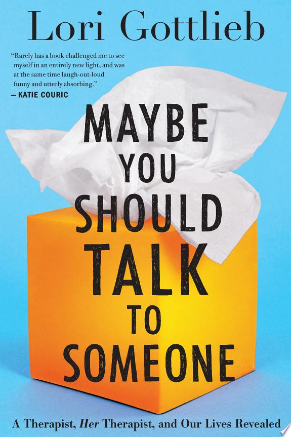

::: {.media-cover}
{fig-alt="Cover"}
:::

Took quite long to finish the book but really liked it, enjoy reading about human relationships and how a therapist would view these relationships

-“Infant (hope)—trust versus mistrust
Toddler (will)—autonomy versus shame
Preschooler (purpose)—initiative versus guilt
School-age child (competence)—industry versus inferiority
Adolescent (fidelity)—identity versus role confusion
Young adult (love)—intimacy versus isolation
Middle-aged adult (care)—generativity versus stagnation
Older adult (wisdom)—integrity versus despair”

## Reading Journey

- 2025-10-31: Finished