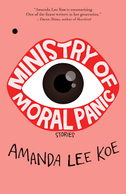

::: {.media-cover}
{fig-alt="Cover"}
:::

Amazing book - need to sit down and write a review on this fr

## Reading Journey
- 2025-07-22: Started
- 2025-07-22: 15
    - 5 mins
- 2025-07-22: 54
    - 13 mins
- 2025-07-22: 111
    - 23 mins
- 2025-07-22: 112
    - 1 mins
- 2025-07-23: 114
    - 1 mins
- 2025-07-23: 116
    - 1 mins
- 2025-07-23: 166
    - 26 mins
- 2025-07-23: 184
    - 12 mins
- 2025-07-23: 224
    - 19 mins
- 2025-07-23: 243
    - 9 mins
- 2025-07-23: 382
    - 59 mins
- 2025-07-24: 383
    - 1 mins
- 2025-07-24: 401
    - 3 mins
- 2025-07-25: 402
    - 1 mins
- 2025-11-04: 403
    - 1 mins
- 2025-11-04: Finished
- Total Time Taken: 2 hours and 55 minutes

## Bookmarks

> The proprietor had never thought of keeping a pet because he thought he’d make a bad owner, but he saw then that not all living things pin all their hopes and dreams on you. Life goes on and it was egotistical to imagine otherwise.
> *Extracted: 2025-07-23 05:37*

> Being able to be sad is a form of happiness too.
> *Extracted: 2025-07-23 05:43*

> she knew that if she ever tried to paint a face, it would look like Nelly, and she could not afford to see Nelly ever again
> *Extracted: 2025-07-23 06:08*

> The truth was probably that my mother had been so defined by the existence of my father that when he died, she couldn’t see anything else before her
> *Extracted: 2025-07-22 16:43*