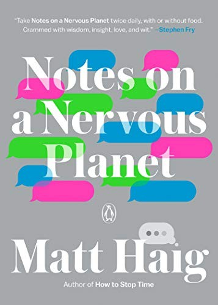

::: {.media-cover}
{fig-alt="Cover"}
:::

## Summary

## Reading Journey
- 2026-07-24: Started
- 2026-07-24: 20
    - 5 mins
- 2026-07-25: 80
    - 47 mins
- 2026-07-25: 108
    - 18 mins
- 2026-07-25: 126
    - 11 mins
- 2026-07-26: 245
    - 96 mins
- 2026-07-26: 246
    - 1 mins
- 2026-10-28: 250
    - 3 mins
- 2026-10-28: Finished
- Total Time Taken: 3 hours and 0 minutes

## Bookmarks
> The thing with mental turmoil is that so many things that make you feel better in the short term make you feel worse in the long term. You distract yourself, when what you really need is to know yourself
> *2026-07-23*

> If (as Emily Dickinson said) “Forever—is composed of Nows—,” maybe the nows are made of maybes. Maybe the point of life is to give up certainty and to embrace life’s beautiful uncertainty
> *2026-07-25*

> Don’t compare your actual self to a hypothetical self. Don’t drown in a sea of “what if”s. Don’t clutter your mind by imagining other versions of you, in parallel universes, where you made different decisions. The internet age encourages choice and comparison, but don’t do this to yourself. “Comparison is the thief of joy,” said Theodore Roosevelt. You are you. The past is the past. The only way to make a better life is from inside the present. To focus on regret does nothing but turn that very present into another thing you will wish you did differently. Accept your own reality. Be human enough to make mistakes. Be human enough not to dread the future. Be human enough to be, well, enough. Accepting where you are in life makes it so much easier to be happy for other people without feeling terrible about yourself
> *2026-07-25*

> One thing mental illness taught me is that progress is a matter of acceptance. Only by accepting a situation can you change it. You have to learn not to be shocked by the shock. Not to be in a state of panic about the panic. To change what you can change and not get frustrated by what you can’t
> *2026-07-26*

> It’s going to bed a little earlier, as the later people go to bed, the less sleep they get. Whereas what time we wake up in the morning makes surprisingly little difference. But
> *2026-07-26*

> When I fall into a frantic or despairing state of mind, full of unwelcome thoughts that can’t slow down, it is often the result of a series, a sequence of things. When I do too much, think too much, absorb too much, eat too badly, sleep too little, work too hard, get too frazzled by life, there it is.
> 			A repetitive strain injury of the mind
> *2026-07-26*

> Breathe. Breathe deep and pure and smooth. Concentrate on it. Breathing is the pace you set your life at. It’s the rhythm of the song of you. It’s how to get back to the center of things. The center of yourself. When the world wants to take you in every other direction. It was the first thing you learned to do. The most essential and simple thing you do. To be aware of breath is to remember you are alive
> *2026-07-26*

> I feel we need to stop seeing mental and physical health as either/or and more as a both/and situation. There is no difference. We are mental. We are physical. We are not split up into unrelated sections. We are not an existential department store. We are everything at once.
> *2026-07-26*

> Nothing I was worried about would fundamentally change anything. I would still be able to walk the dog. I would still be able to look at the sea. I would still be able to spend time with the people I love.
> 			The anxiety retreated, like a criminal under the spotlight of an investigation
> *2026-07-26*

> But just as there is only one planet—a planet with finite resources—there is also only one you. And you also have a finite resource—time. And, let’s face it, you can’t multiply yourself. An overloaded planet cajoles us into overloaded lives but, ultimately, you can’t play with all the toys. You can’t use all the apps. You can’t be at all the parties. You can’t do the work of 20 people. You can’t be up to speed on all the news. You can’t wear all eleven of your coats at once. You can’t watch every must-see show. You can’t live in two places at once. You can buy more, you can acquire more, you can work more, you can earn more, you can strive more, you can tweet more, you can watch more, you can want more, but as each new buzz diminishes there comes a point where you have to ask yourself: what is all this for?
> *2026-07-26*