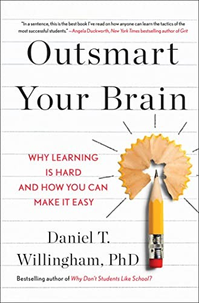

::: {.media-cover}
{fig-alt="Cover"}
:::

## Summary

## Reading Journey
- 2026-07-08: Started
- 2026-07-08: 59
    - 54 mins
- 2026-07-08: 61
    - 2 mins
- 2026-07-09: 86
    - 9 mins
- 2026-07-09: 155
    - 35 mins
- 2026-07-10: 189
    - 6 mins
- 2026-07-10: 190
    - 2 mins
- 2026-07-10: 191
    - 2 mins
- 2026-07-10: 192
    - 2 mins
- 2026-07-10: Finished
- Total Time Taken: 1 hours and 51 minutes