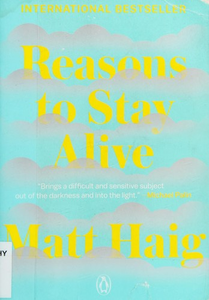

::: {.media-cover}
{fig-alt="Cover"}
:::

## Summary

## Reading Journey
- 2026-08-12: Started
- 2026-08-12: 40
    - 20 mins
- 2026-09-17: 56
    - 10 mins
- 2026-09-18: 65
    - 10 mins
- 2026-09-22: 84
    - 14 mins
- 2026-10-15: 98
    - 14 mins
- 2026-10-16: 123
    - 25 mins
- 2026-10-20: 145
    - 16 mins
- 2026-10-20: 172
    - 13 mins
- 2026-10-27: 173
    - 1 mins
- 2026-10-27: 174
    - 1 mins
- 2026-10-27: Finished
- Total Time Taken: 2 hours and 4 minutes

## Bookmarks
> Maybe love is just about finding the person you can be your weird self with.
> I helped her be her, and she helped me be me.
> *2026-10-15*

> I was there, not exactly above myself, but above and beside and everywhere all at once, watching and hearing myself in a state of such heightened self-consciousness I’d actually burst right out of myself altogether.
> *2026-10-20*