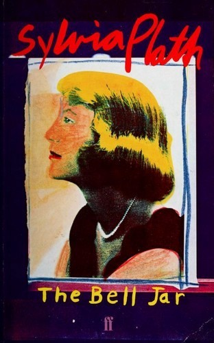

::: {.media-cover}
{fig-alt="Cover"}
:::

## Summary

## Reading Journey
- 2026-07-26: Started
- 2026-07-26: 11
    - 3 mins
- 2026-07-26: 49
    - 10 mins
- 2026-07-28: 65
    - 16 mins
- 2026-07-29: 73
    - 4 mins
- 2026-08-01: 94
    - 11 mins
- 2026-08-01: 141
    - 59 mins
- 2026-08-01: 174
    - 22 mins
- 2026-08-03: 184
    - 11 mins
- 2026-08-03: 213
    - 25 mins
- 2026-08-04: 226
    - 14 mins
- 2026-08-05: 231
    - 7 mins
- 2026-08-05: 236
    - 5 mins
- 2026-08-05: 241
    - 1 mins
- 2026-08-06: 282
    - 29 mins
- 2026-08-12: 304
    - 14 mins
- 2026-08-12: 335
    - 18 mins
- 2026-08-12: Finished
- Total Time Taken: 4 hours and 9 minutes

## Bookmarks
> I would simply have to ambush it with whatever sense I
> had left, or it would trap me in its stupid cage for fifty years
> without any sense at all. And when people found out my
> mind had gone, as they would have to, sooner or later, in
> spite of my mother's guarded tongue, they would persuade
> her to put me into an asylum where I could be cured
> *2026-08-04*