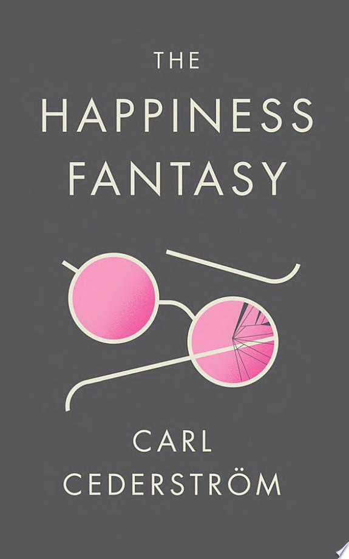

::: {.media-cover}
{fig-alt="Cover"}
:::

Again, this is a post review so i dont remember exactly the contents of the book, but imo, i feel that the book is very descriptive, the insights it provides are interesting? But relatively shallow? Some include the idea of social media and how it promotes narcissism, which, at this point, is overdone and overunderstood. I remember that it wasnt a very engaging read either so thats that

## Reading Journey
- 2026-01-07: Started
- 2026-01-07: 1
    - 1 mins
- Total Time Taken: 1 minutes

## Bookmarks