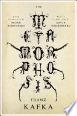

::: {.media-cover}
{fig-alt="Cover"}
:::

I liked it, it was easy to follow and somewhat easy to relate and understand, which is something that i think isnt very common with all these "classics" and an understandable book is a hard find

## Reading Journey

- 2025-10-31: Finished