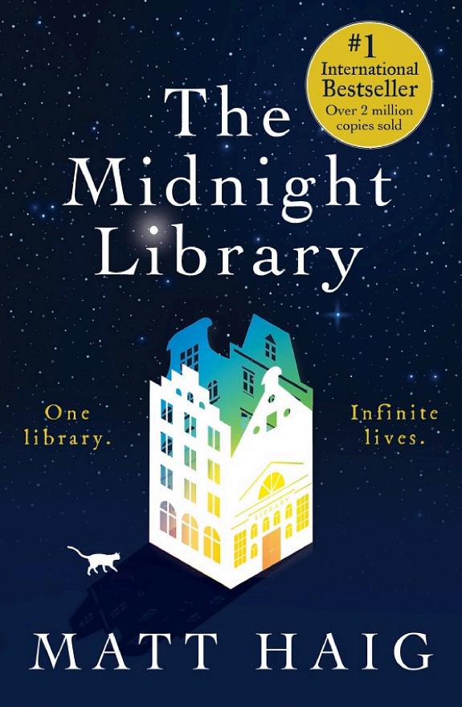

::: {.media-cover}
{fig-alt="Cover"}
:::

I liked the concept; being able to expereince every life that there is to experience and still going back to the original life of the author, but it comes off as a little preachy? Feels like too much of a feel good story and is a little slow at times, but overall a good read

## Reading Journey
- 2026-01-07: Started
- 2026-01-07: 1
    - 1 mins
- 2026-01-07: Finished
- Total Time Taken: 1 minutes

## Bookmarks