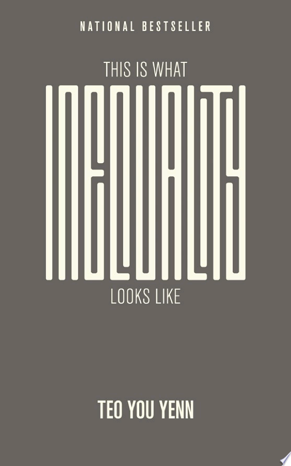

::: {.media-cover}
{fig-alt="Cover"}
:::

Really insightful read into the face of inequality in singapore and the systemic factors that have lead to this and what we can do about it  //Maybe sweden is different. Of course sweden is different. But within our own culture—past and present—live values, beliefs, habits, aspirations, that we can fight to own. This is what inequality looks like. Now what? Now we refuse

## Reading Journey
- 2025-07-25: Started
- 2025-07-25: 9
    - 1 mins
- 2025-07-25: 159
    - 49 mins
- 2025-07-25: 297
    - 68 mins
- 2025-07-25: 320
    - 11 mins
- 2025-07-27: 345
    - 15 mins
- 2025-07-27: 512
    - 68 mins
- 2025-07-28: 513
    - 1 mins
- 2025-08-19: 514
    - 1 mins
- 2025-08-19: Finished
- Total Time Taken: 3 hours and 34 minutes