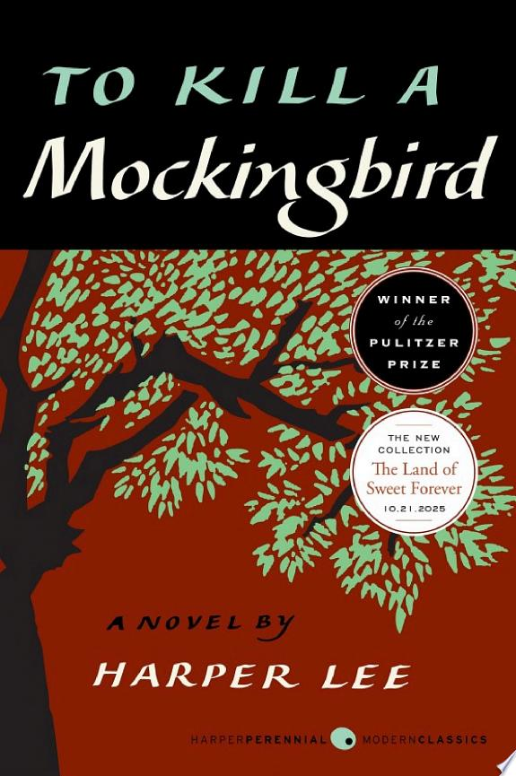

::: {.media-cover}
{fig-alt="Cover"}
:::

Forgot when i finished, i think i listened to the audiobook, i liked it but it was quite weird, focused on the lives of the children at the start then turned heavy and focused on the court hearing and maybe that might have been the intention of the author, the jarringness and coming of ageness was interrupted by the trial on the injustice of the court hearing. Overall nice

## Reading Journey

- 2025-10-31: Finished