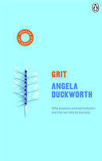

<!-- Generated by reading-sync (kobostatisticsdatareader). Edits here get overwritten. -->

Other years: **2026** · [2025](2025.qmd)

```{=html}
<div class="stat-cards"><div class="stat-card"><div class="stat-value">14<span class="stat-of"> / 20</span></div><div class="stat-label">Books finished</div></div><div class="stat-card"><div class="stat-value">46</div><div class="stat-label">Hours read</div></div><div class="stat-card"><div class="stat-value">3,100</div><div class="stat-label">Pages turned</div></div><div class="stat-card"><div class="stat-value">78</div><div class="stat-label">Reading days</div></div><div class="stat-card"><div class="stat-value">7 days</div><div class="stat-label">Longest streak</div></div><div class="stat-card"><div class="stat-value">4.0★</div><div class="stat-label">Avg rating</div></div><div class="stat-card"><div class="stat-value">35</div><div class="stat-label">Films logged</div></div></div>
```

## Month by month

```{=html}
<div class="yr-charts"><div class="yr-chart"><div class="yr-chart-title">Books finished</div><svg class="mini-chart" viewBox="0 0 400 150" role="img" aria-label="J: 2, F: 3, M: 0, A: 1, M: 1, J: 0, J: 3, A: 1, S: 1, O: 2, N: 0, D: 0"><rect x="6.3" y="56.0" width="20.7" height="76.0" rx="2" fill="#0d6efd" opacity="1"><title>J: 2</title></rect><text x="16.7" y="52.0" class="mini-chart-val">2</text><text x="16.7" y="146" class="mini-chart-lab">J</text><rect x="39.7" y="18.0" width="20.7" height="114.0" rx="2" fill="#0d6efd" opacity="1"><title>F: 3</title></rect><text x="50.0" y="14.0" class="mini-chart-val">3</text><text x="50.0" y="146" class="mini-chart-lab">F</text><rect x="73.0" y="132.0" width="20.7" height="0.0" rx="2" fill="#0d6efd" opacity="0.15"><title>M: 0</title></rect><text x="83.3" y="146" class="mini-chart-lab">M</text><rect x="106.3" y="94.0" width="20.7" height="38.0" rx="2" fill="#0d6efd" opacity="1"><title>A: 1</title></rect><text x="116.7" y="90.0" class="mini-chart-val">1</text><text x="116.7" y="146" class="mini-chart-lab">A</text><rect x="139.7" y="94.0" width="20.7" height="38.0" rx="2" fill="#0d6efd" opacity="1"><title>M: 1</title></rect><text x="150.0" y="90.0" class="mini-chart-val">1</text><text x="150.0" y="146" class="mini-chart-lab">M</text><rect x="173.0" y="132.0" width="20.7" height="0.0" rx="2" fill="#0d6efd" opacity="0.15"><title>J: 0</title></rect><text x="183.3" y="146" class="mini-chart-lab">J</text><rect x="206.3" y="18.0" width="20.7" height="114.0" rx="2" fill="#0d6efd" opacity="1"><title>J: 3</title></rect><text x="216.7" y="14.0" class="mini-chart-val">3</text><text x="216.7" y="146" class="mini-chart-lab">J</text><rect x="239.7" y="94.0" width="20.7" height="38.0" rx="2" fill="#0d6efd" opacity="1"><title>A: 1</title></rect><text x="250.0" y="90.0" class="mini-chart-val">1</text><text x="250.0" y="146" class="mini-chart-lab">A</text><rect x="273.0" y="94.0" width="20.7" height="38.0" rx="2" fill="#0d6efd" opacity="1"><title>S: 1</title></rect><text x="283.3" y="90.0" class="mini-chart-val">1</text><text x="283.3" y="146" class="mini-chart-lab">S</text><rect x="306.3" y="56.0" width="20.7" height="76.0" rx="2" fill="#0d6efd" opacity="1"><title>O: 2</title></rect><text x="316.7" y="52.0" class="mini-chart-val">2</text><text x="316.7" y="146" class="mini-chart-lab">O</text><rect x="339.7" y="132.0" width="20.7" height="0.0" rx="2" fill="#0d6efd" opacity="0.15"><title>N: 0</title></rect><text x="350.0" y="146" class="mini-chart-lab">N</text><rect x="373.0" y="132.0" width="20.7" height="0.0" rx="2" fill="#0d6efd" opacity="0.15"><title>D: 0</title></rect><text x="383.3" y="146" class="mini-chart-lab">D</text></svg></div><div class="yr-chart"><div class="yr-chart-title">Hours read</div><svg class="mini-chart" viewBox="0 0 400 150" role="img" aria-label="J: 6, F: 1, M: 3, A: 1, M: 6, J: 6, J: 12, A: 6, S: 4, O: 2, N: 0, D: 0"><rect x="6.3" y="75.0" width="20.7" height="57.0" rx="2" fill="#198754" opacity="1"><title>J: 6 h</title></rect><text x="16.7" y="71.0" class="mini-chart-val">6</text><text x="16.7" y="146" class="mini-chart-lab">J</text><rect x="39.7" y="122.5" width="20.7" height="9.5" rx="2" fill="#198754" opacity="1"><title>F: 1 h</title></rect><text x="50.0" y="118.5" class="mini-chart-val">1</text><text x="50.0" y="146" class="mini-chart-lab">F</text><rect x="73.0" y="103.5" width="20.7" height="28.5" rx="2" fill="#198754" opacity="1"><title>M: 3 h</title></rect><text x="83.3" y="99.5" class="mini-chart-val">3</text><text x="83.3" y="146" class="mini-chart-lab">M</text><rect x="106.3" y="122.5" width="20.7" height="9.5" rx="2" fill="#198754" opacity="1"><title>A: 1 h</title></rect><text x="116.7" y="118.5" class="mini-chart-val">1</text><text x="116.7" y="146" class="mini-chart-lab">A</text><rect x="139.7" y="75.0" width="20.7" height="57.0" rx="2" fill="#198754" opacity="1"><title>M: 6 h</title></rect><text x="150.0" y="71.0" class="mini-chart-val">6</text><text x="150.0" y="146" class="mini-chart-lab">M</text><rect x="173.0" y="75.0" width="20.7" height="57.0" rx="2" fill="#198754" opacity="1"><title>J: 6 h</title></rect><text x="183.3" y="71.0" class="mini-chart-val">6</text><text x="183.3" y="146" class="mini-chart-lab">J</text><rect x="206.3" y="18.0" width="20.7" height="114.0" rx="2" fill="#198754" opacity="1"><title>J: 12 h</title></rect><text x="216.7" y="14.0" class="mini-chart-val">12</text><text x="216.7" y="146" class="mini-chart-lab">J</text><rect x="239.7" y="75.0" width="20.7" height="57.0" rx="2" fill="#198754" opacity="1"><title>A: 6 h</title></rect><text x="250.0" y="71.0" class="mini-chart-val">6</text><text x="250.0" y="146" class="mini-chart-lab">A</text><rect x="273.0" y="94.0" width="20.7" height="38.0" rx="2" fill="#198754" opacity="1"><title>S: 4 h</title></rect><text x="283.3" y="90.0" class="mini-chart-val">4</text><text x="283.3" y="146" class="mini-chart-lab">S</text><rect x="306.3" y="113.0" width="20.7" height="19.0" rx="2" fill="#198754" opacity="1"><title>O: 2 h</title></rect><text x="316.7" y="109.0" class="mini-chart-val">2</text><text x="316.7" y="146" class="mini-chart-lab">O</text><rect x="339.7" y="132.0" width="20.7" height="0.0" rx="2" fill="#198754" opacity="0.15"><title>N: 0 h</title></rect><text x="350.0" y="146" class="mini-chart-lab">N</text><rect x="373.0" y="132.0" width="20.7" height="0.0" rx="2" fill="#198754" opacity="0.15"><title>D: 0 h</title></rect><text x="383.3" y="146" class="mini-chart-lab">D</text></svg></div></div>
```

## Highlights

```{=html}
<div class="yr-facts"><div class="yr-fact"><div class="yr-fact-label">Most time spent</div><div class="yr-fact-value">Wild Swans</div><div class="yr-fact-sub">14.0 hours</div></div><div class="yr-fact"><div class="yr-fact-label">Quickest finish</div><div class="yr-fact-value">The Midnight Library</div><div class="yr-fact-sub">1 day</div></div><div class="yr-fact"><div class="yr-fact-label">Longest book</div><div class="yr-fact-value">East of Eden</div><div class="yr-fact-sub">235,826 words</div></div><div class="yr-fact"><div class="yr-fact-label">Most-read author</div><div class="yr-fact-value">Matt Haig</div><div class="yr-fact-sub">3 books</div></div><div class="yr-fact"><div class="yr-fact-label">Biggest month</div><div class="yr-fact-value">Feb</div><div class="yr-fact-sub">3 books finished</div></div><div class="yr-fact"><div class="yr-fact-label">Favourite reading day</div><div class="yr-fact-value">Wednesday</div></div></div>
```

## Favourite books (9)

```{=html}
<div class="yr-covers yr-books"><a class="yr-cover" href="../readings/East%20of%20Eden/"><div class="yr-cap">East of Eden<span>★★★★★</span></div></a><a class="yr-cover" href="../readings/Wild%20Swans/"><div class="yr-cap">Wild Swans<span>★★★★★</span></div></a><a class="yr-cover" href="../readings/I%20Want%20to%20Die%20but%20I%20Want%20to%20Eat%20Tteokbokki/"><div class="yr-cap">I Want to Die but I Want to Eat Tteokbokki<span>★★★★★</span></div></a><a class="yr-cover" href="../readings/The%20Bell%20Jar/"><div class="yr-cap">The Bell Jar<span>★★★★★</span></div></a><a class="yr-cover" href="../readings/Klara%20and%20the%20Sun/"><div class="yr-cap">Klara and the Sun<span>★★★★★</span></div></a><a class="yr-cover" href="../readings/The%20Midnight%20Library/"><div class="yr-cap">The Midnight Library<span>★★★★</span></div></a><a class="yr-cover" href="../readings/Grit/"><div class="yr-cap">Grit<span>★★★★</span></div></a><a class="yr-cover" href="../readings/Reasons%20to%20stay%20alive/"><div class="yr-cap">Reasons to stay alive<span>★★★★</span></div></a><a class="yr-cover" href="../readings/Notes%20on%20a%20Nervous%20Planet/"><div class="yr-cap">Notes on a Nervous Planet<span>★★★★</span></div></a></div>
```

## What I read

```{=html}
<div class="yr-genres"><div class="yr-genre"><span>Fiction</span><div class="yr-genre-bar"><div style="width:100%"></div></div><b>6</b></div><div class="yr-genre"><span>Psychology</span><div class="yr-genre-bar"><div style="width:67%"></div></div><b>4</b></div><div class="yr-genre"><span>Biography &amp; Autobiography</span><div class="yr-genre-bar"><div style="width:50%"></div></div><b>3</b></div><div class="yr-genre"><span>Business &amp; Economics</span><div class="yr-genre-bar"><div style="width:17%"></div></div><b>1</b></div></div>
```

## Favourite films (31)

```{=html}
<div class="yr-covers yr-films"><a class="yr-cover" href="../watched/Baby%20Driver%20%282017%29/"><div class="yr-cap">Baby Driver<span>★★★★★</span></div></a><a class="yr-cover" href="../watched/Eternal%20Sunshine%20of%20the%20Spotless%20Mind%20%282004%29/"><div class="yr-cap">Eternal Sunshine of the Spotless Mind<span>★★★★★</span></div></a><a class="yr-cover" href="../watched/Everything%20Everywhere%20All%20at%20Once%20%282022%29/"><div class="yr-cap">Everything Everywhere All at Once<span>★★★★★</span></div></a><a class="yr-cover" href="../watched/Fantastic%20Mr.%20Fox%20%282009%29/"><div class="yr-cap">Fantastic Mr. Fox<span>★★★★★</span></div></a><a class="yr-cover" href="../watched/Forrest%20Gump%20%281994%29/"><div class="yr-cap">Forrest Gump<span>★★★★★</span></div></a><a class="yr-cover" href="../watched/Inception%20%282010%29/"><div class="yr-cap">Inception<span>★★★★★</span></div></a><a class="yr-cover" href="../watched/Inglourious%20Basterds%20%282009%29/"><div class="yr-cap">Inglourious Basterds<span>★★★★★</span></div></a><a class="yr-cover" href="../watched/Interstellar%20%282014%29/"><div class="yr-cap">Interstellar<span>★★★★★</span></div></a><a class="yr-cover" href="../watched/La%20La%20Land%20%282016%29/"><div class="yr-cap">La La Land<span>★★★★★</span></div></a><a class="yr-cover" href="../watched/Midsommar%20%282019%29/"><div class="yr-cap">Midsommar<span>★★★★★</span></div></a><a class="yr-cover" href="../watched/Parasite%20%282019%29/"><div class="yr-cap">Parasite<span>★★★★★</span></div></a><a class="yr-cover" href="../watched/Past%20Lives%20%282023%29/"><div class="yr-cap">Past Lives<span>★★★★★</span></div></a><a class="yr-cover" href="../watched/Ratatouille%20%282007%29/"><div class="yr-cap">Ratatouille<span>★★★★★</span></div></a><a class="yr-cover" href="../watched/Se7en%20%281995%29/"><div class="yr-cap">Se7en<span>★★★★★</span></div></a><a class="yr-cover" href="../watched/Spirited%20Away%20%282001%29/"><div class="yr-cap">Spirited Away<span>★★★★★</span></div></a><a class="yr-cover" href="../watched/The%20Dark%20Knight%20%282008%29/"><div class="yr-cap">The Dark Knight<span>★★★★★</span></div></a><a class="yr-cover" href="../watched/The%20Grand%20Budapest%20Hotel%20%282014%29/"><div class="yr-cap">The Grand Budapest Hotel<span>★★★★★</span></div></a><a class="yr-cover" href="../watched/The%20Odyssey%20%282026%29/"><div class="yr-cap">The Odyssey<span>★★★★★</span></div></a><a class="yr-cover" href="../watched/The%20Perks%20of%20Being%20a%20Wallflower%20%282012%29/"><div class="yr-cap">The Perks of Being a Wallflower<span>★★★★★</span></div></a><a class="yr-cover" href="../watched/Whiplash%20%282014%29/"><div class="yr-cap">Whiplash<span>★★★★★</span></div></a><a class="yr-cover" href="../watched/American%20Psycho%20%282000%29/"><div class="yr-cap">American Psycho<span>★★★★</span></div></a><a class="yr-cover" href="../watched/Avengers%20Infinity%20War%20%282018%29/"><div class="yr-cap">Avengers: Infinity War<span>★★★★</span></div></a><a class="yr-cover" href="../watched/Black%20Swan%20%282010%29/"><div class="yr-cap">Black Swan<span>★★★★</span></div></a><a class="yr-cover" href="../watched/Dead%20Poets%20Society%20%281989%29/"><div class="yr-cap">Dead Poets Society<span>★★★★</span></div></a><a class="yr-cover" href="../watched/Fight%20Club%20%281999%29/"><div class="yr-cap">Fight Club<span>★★★★</span></div></a><a class="yr-cover" href="../watched/Knives%20Out%20%282019%29/"><div class="yr-cap">Knives Out<span>★★★★</span></div></a><a class="yr-cover" href="../watched/Oppenheimer%20%282023%29/"><div class="yr-cap">Oppenheimer<span>★★★★</span></div></a><a class="yr-cover" href="../watched/Taxi%20Driver%20%281976%29/"><div class="yr-cap">Taxi Driver<span>★★★★</span></div></a><a class="yr-cover" href="../watched/The%20Lord%20of%20the%20Rings%20The%20Fellowship%20of%20the%20Ring%20%282001%29/"><div class="yr-cap">The Lord of the Rings: The Fellowship of the Ring<span>★★★★</span></div></a><a class="yr-cover" href="../watched/The%20Shawshank%20Redemption%20%281994%29/"><div class="yr-cap">The Shawshank Redemption<span>★★★★</span></div></a><a class="yr-cover" href="../watched/The%20Wolf%20of%20Wall%20Street%20%282013%29/"><div class="yr-cap">The Wolf of Wall Street<span>★★★★</span></div></a></div>
```

## Every book finished

| Finished | Book | Author | Rating |
|---|---|---|---|
| 28 Oct | [Notes on a Nervous Planet](../readings/Notes%20on%20a%20Nervous%20Planet/) | Matt Haig | ★★★★ |
| 27 Oct | [Reasons to stay alive](../readings/Reasons%20to%20stay%20alive/) | Matt Haig | ★★★★ |
| 15 Sep | [Klara and the Sun](../readings/Klara%20and%20the%20Sun/) | Kazuo Ishiguro | ★★★★★ |
| 12 Aug | [The Bell Jar](../readings/The%20Bell%20Jar/) | Sylvia Plath | ★★★★★ |
| 10 Jul | [Outsmart Your Brain](../readings/Outsmart%20Your%20Brain/) | Daniel T. Willingham | ★★ |
| 08 Jul | [I Want to Die but I Want to Eat Tteokbokki](../readings/I%20Want%20to%20Die%20but%20I%20Want%20to%20Eat%20Tteokbokki/) | Baek Sehee | ★★★★★ |
| 06 Jul | [Wild Swans](../readings/Wild%20Swans/) | Jung Chang | ★★★★★ |
| 13 May | [Grit](../readings/Grit/) | Angela Duckworth | ★★★★ |
| 23 Apr | [East of Eden](../readings/East%20of%20Eden/) | John Steinbeck | ★★★★★ |
| 27 Feb | [Never Let Me Go](../readings/Never%20Let%20Me%20Go/) | Kazuo Ishiguro | ★★★ |
| 27 Feb | Attached | Amir Levine |  |
| 13 Feb | A Beginner's Guide to Dying | Simon Boas |  |
| 07 Jan | [The Midnight Library](../readings/The%20Midnight%20Library/) | Matt Haig | ★★★★ |
| 07 Jan | [Heart Lamp: Selected Stories](../readings/Heart%20Lamp%20Selected%20Stories/) | Banu Mushtaq | ★★ |
