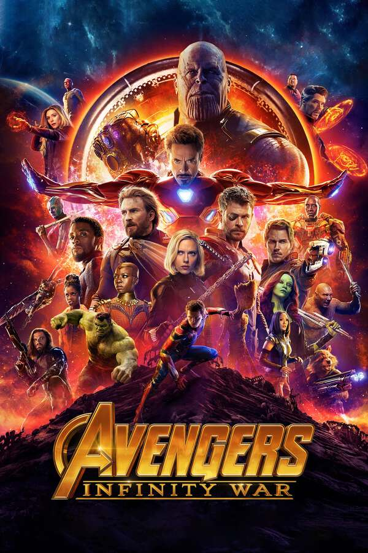

::: {.media-cover}
{fig-alt="Cover"}
:::

## Letterboxd Review
Ok i mean of all the marvel movies this one is the best, Thanos wins which i love, but still, at the end of the next movie he loses so then what's the point. Thanos did nothing wrong. But he could have just doubled the resources instead of halving the population but who's to say how the marvel universe works ya

[View on Letterboxd](https://letterboxd.com/film/avengers-infinity-war/)
