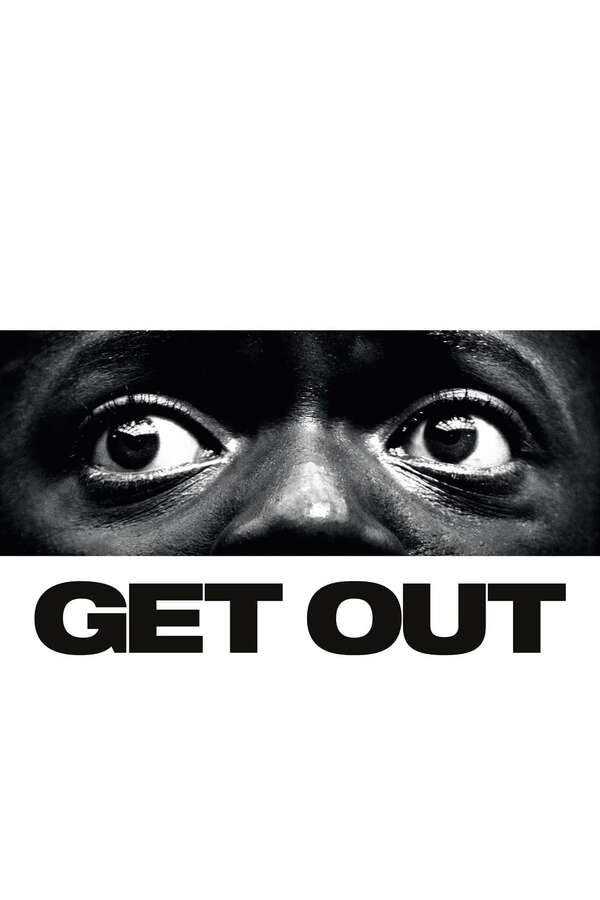

::: {.media-cover}
{fig-alt="Cover"}
:::

## Letterboxd Review
Ok i get why people would like this, but i feel it was a concept that was interesting for like 10 mins then it really got old and the rest of the movie was just slow rolling the concept, and good execution but still, i dont' love it

[View on Letterboxd](https://letterboxd.com/film/get-out-2017/)
