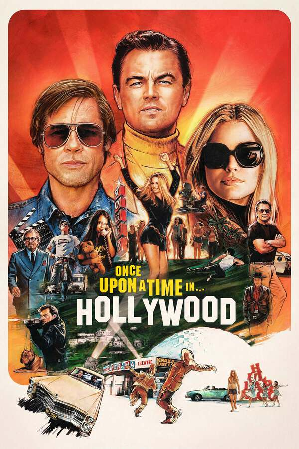

::: {.media-cover}
{fig-alt="Cover"}
:::

## Letterboxd Review
Yeah somehow i mean its a good film, but its somewhat like a random movie, and highly likely bad take but its like pulp fiction, slightly disconnected which personally i don't enjoy

[View on Letterboxd](https://letterboxd.com/film/once-upon-a-time-in-hollywood/)
