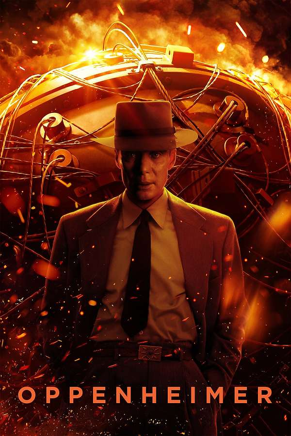

::: {.media-cover}
{fig-alt="Cover"}
:::

## Letterboxd Review
Not bad i really liked the soundtrack and the magnitude of the movie, and quite a stupid opinion, but i felt the story was boring, and it has to be since its a reenactment of a real life story. But despite that i feel the key points were really interesting and captured the nuances behind the invention and how it affected the real lives of people and not just oh bomb bad, many people die. There was a nuance to it that i enjoyed and so would watch. Minus one star for the story as above, but not Mr Dolan's fault is arite dolan

[View on Letterboxd](https://letterboxd.com/film/oppenheimer-2023/)
