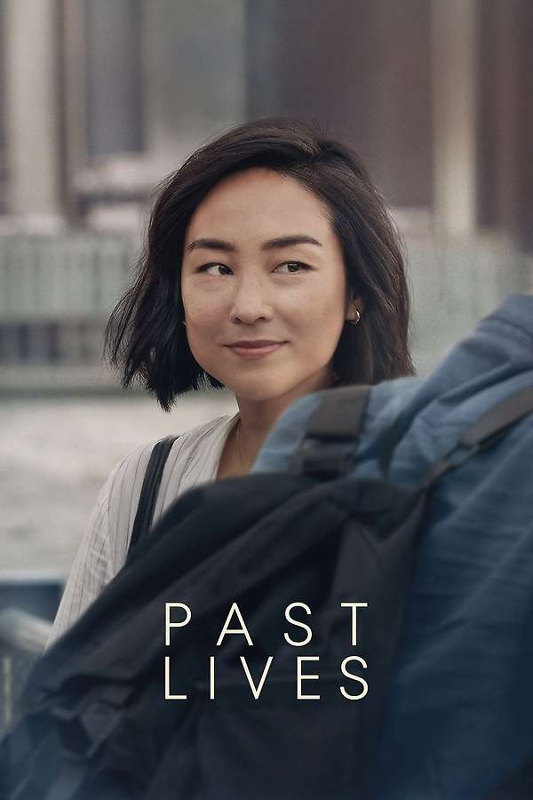

::: {.media-cover}
{fig-alt="Cover"}
:::

## Letterboxd Review
GAGGED. Love these kind of bittersweet slice of life kinda movies because in life, the ending is not always happy, there's always a nuance to everything. The cinematography was crazy amazing, i love some of the shots like the camera looking in on the glass. The use of language as not just a "physical" but a spiritual barrier was something that i found interesting. And as the manifestation of "right person wrong time", this movie made me think if there ever is a wrong time or if its all just a fig tree. Seasons change, people come and go, it matters not if the fig plucked was the right one, and if one consumes the chosen fig while always thinking about the sweetness of the others, come winter they'll be starved and the tree will be bare. 

I enjoy the idea of Inyeon, letting what will be be, noodles, don't noodles. I guess living life without trying to control the flow of the river, simply feeling the water run through your hands. Everything works out in the end because that's the only thing that can happen.

[View on Letterboxd](https://letterboxd.com/film/past-lives/)
